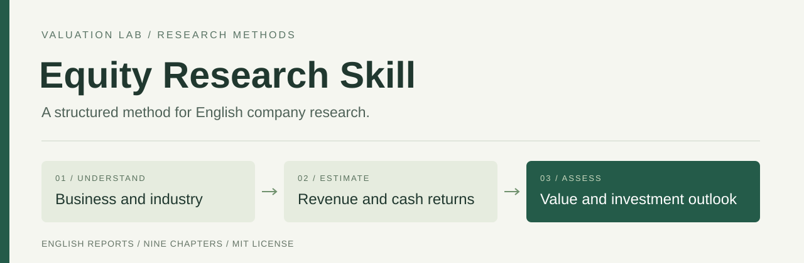
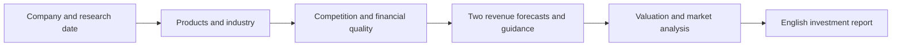

<p align="center"></p>

# Equity Research Skill

**An English company-research workflow from [Valuation Lab](https://github.com/zhanfengchen1996-hash/valuation-lab).**

Understand what a company sells, why it grows, how that growth is funded and what it means for shareholders. This skill organizes the research into a detailed investment report with two paths to next-quarter revenue, an independent valuation view and US market technical analysis.

**Instruction-based release · English reports · MIT license**

[Read the skill](skills/equity-research/SKILL.md) · [Report template](skills/equity-research/assets/report-template.md) · [Word template](skills/equity-research/assets/report-template.docx) · [Research method](skills/equity-research/references/research-method.md)

## What this release contains

The package contains a research Skill, analytical references, an editable English report blueprint and a Word template. It is designed for US-listed non-financial companies. Research access, calculations and document export are supplied by the agent environment in which the skill runs.

The default full report develops a 1–4 week market view and a 1–3 year investment view. Users can also request a single chapter or update an existing dated report.



## The report

| Section | The investment question |
|---|---|
| Executive Summary | What is the investment judgment and what drives it? |
| 1 Business and Products | What does the customer buy, and how does the company earn revenue? |
| 2 Industry and Market Outlook | Which demand, supply and pricing changes affect the business? |
| 3 Competition and Competitive Advantage | What sustains pricing, retention and returns on capital? |
| 4 Financial Performance and Cash Flow | What explains growth, earnings quality and funding needs? |
| 5 Next Quarter Revenue Forecast | What do industry demand and operating execution imply for revenue? |
| 6 Economic and Policy Environment | How do external developments change company economics? |
| 7 Valuation and Investment Bank Views | Which assumptions explain value and institutional disagreement? |
| 8 Share Price Trends and Near Term View | What do US price, relative-return and liquidity measures show? |
| 9 Long Term Outlook and Investment Conclusion | How does business growth translate into shareholder cash returns? |

Each argument connects a judgment to evidence, an economic mechanism and a financial consequence. Sources are consolidated in an appendix. Estimates retain their assumptions, reporting periods and units.

## Use with Codex

Ask the Skill Installer to install the `skills/equity-research` folder from this repository, or copy that entire folder into your project's `.agents/skills/` directory. The folder contains its own references and report templates. See the [official skill documentation](https://learn.chatgpt.com/docs/build-skills) for host-specific discovery and installation.

Then invoke it with a company and a research date, for example:

```text
Use $equity-research to prepare an English investment report on ORCL
as of today's date. Explain its products, forecast next-quarter revenue
through top-down and bottom-up paths, compare management guidance,
and develop separate near-term and long-term investment views.
```

Or request a focused update:

```text
Use $equity-research to update the next-quarter revenue and funding
analysis for APLD using its latest released financial statements.
Write in English and preserve the report's fiscal-period definitions.
```

The host needs web or document access and numerical tools for calculations. Markdown is the default output; Word and HTML delivery use the host's available export tools. The repository contains no API runner, data connector or automatic report exporter. Users run the workflow with their own authorized tools and accounts; no shared API credential is required by these files.

## Research standards

- Explain main products, customer uses, charging models and the value chain before analyzing the stock.
- Separate industry expansion from company execution; establish market-share changes with matched market data.
- Integrate the five competitive forces, PESTLE and company strategy into financial reasoning.
- Reconcile cash generation, capital expenditure, debt maturities and dilution.
- Build both revenue forecasts for the same fiscal quarter, then explain their weights and differences from guidance.
- Distinguish reported results, management guidance, market expectations and analyst assumptions.
- Use direct, connected English with explicit reasoning and company-specific downside mechanisms.

The [research method](skills/equity-research/references/research-method.md) defines the numerical conventions. The [report standard](skills/equity-research/references/report-standard.md) defines chapter responsibilities and writing quality.

## Relationship to Valuation Lab

[Valuation Lab](https://github.com/zhanfengchen1996-hash/valuation-lab) is the broader investment-research application. This repository makes its company-assessment methodology available as a standalone Skill and report template. Application features such as FOMC scenarios, supply-chain imports and trading review remain part of the Lab.

## License

Original repository content is available under the [MIT License](LICENSE). Third-party filings, research and data remain subject to their respective terms and are referenced through source links.

Created by [Ethan Chen](https://github.com/zhanfengchen1996-hash).
